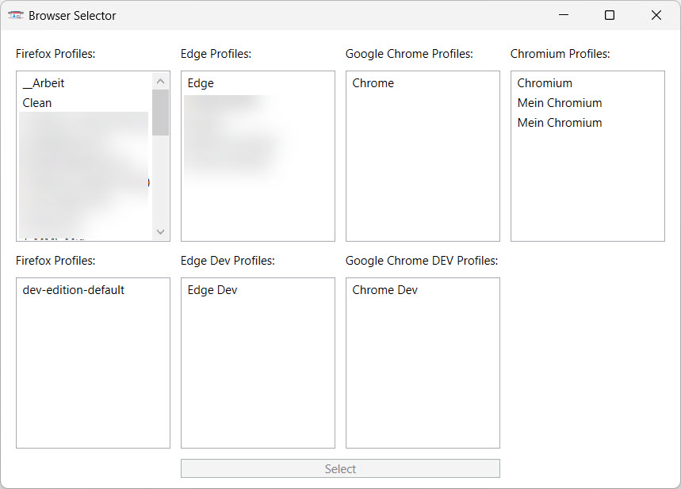
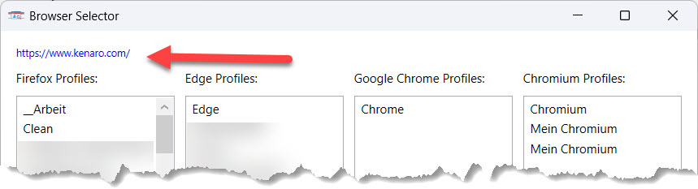

# kenaro BrowserSelect

## Streamline Your Workflow with Effortless Browser & Profile Switching

**kenaro BrowserSelect** offers a swift and intuitive solution for launching the right browser with the right profile for any task.

As a software developer or freelance consultant, you likely juggle multiple clients, projects, and accounts. This often means managing numerous browser profiles to keep logins, cookies, and histories separate. For instance:

  * **Multiple Microsoft Teams accounts** for different clients, each requiring its own dedicated Edge profile to run simultaneously.
  * **Distinct Azure subscriptions** with unique credentials, necessitating separate browser profiles for streamlined access.
  * **A mix of personal and work accounts** across various services where isolation is crucial for privacy and organization.

BrowserSelect simplifies this complexity. By integrating with Windows as a **default web browser**, it intercepts any link you click and presents a clean interface to choose the desired browser and profile. This eliminates the need to manually open a specific browser or juggle multiple windows.

The tool automatically detects installations of the following browsers, ensuring only relevant options are displayed:

  * Firefox & Waterfox
  * Microsoft Edge & Helium
  * Google Chrome & Brave
  * Chromium

*I built this as a quick and effective tool to scratch my own itch; it's designed to get the job done without fuss. The application is currently in **beta**, and contributions are welcome\!*

-----

## Getting Started

Simply copy the executable file to any location on your computer.

### Windows Integration (Optional)

To make BrowserSelect available in the "Default Apps" list in Windows for handling web links (HTTP/HTTPS), run the following command in a terminal:

```cmd
BrowserSelect.exe --install
```

After running the command, navigate to **Windows Settings \> Apps \> Default apps** and set **kenaro BrowserSelect** as your default web browser.

### Manual Link Opening

To open a specific URL with your choice of browser and profile on the fly, use this command:

```cmd
BrowserSelect.exe "https://your-url.com"
```

### Direct Browser Launch

To launch the application to select a browser and profile without opening a specific URL, run it directly:

```cmd
BrowserSelect.exe
```

-----

## Usage

Once the application is open, you can launch a browser profile in several ways:

  * **Double-click** on a profile name.
  * Use the **Tab** and **Arrow Keys** to navigate to a profile, then press **Enter**.
  * **Single-click** a profile to highlight it, then click the **Select** button.

-----

## Screenshots

The main application window provides a clear overview of all detected browsers and their available profiles.



When a link is opened via BrowserSelect, the target URL is displayed at the top of the window. This allows you to confirm the link before choosing the appropriate browser and profile.



## App Logo

The application logo was created with Google Gemini.

-----

### Summary of Key Changes:

  * **Clarity and Flow:** Minor sentence restructuring for better readability (e.g., "Just copy the tool..." to "Simply copy the executable file...").
  * **Consistency:** Used consistent terminology like "web browser" and "application."
  * **Formatting:** Improved the call-out for the "beta" status by italicizing the entire paragraph for emphasis. Corrected the code block language identifier to `cmd`.
  * **"Usage" Section:** Re-organized the instructions into a more scannable list, making it clearer and more direct.
  * **Screenshot Captions:** Slightly rephrased for a more concise description.
  * **Minor Edits:** General proofreading for grammar and punctuation.